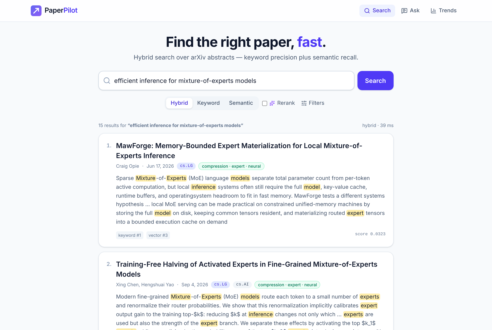
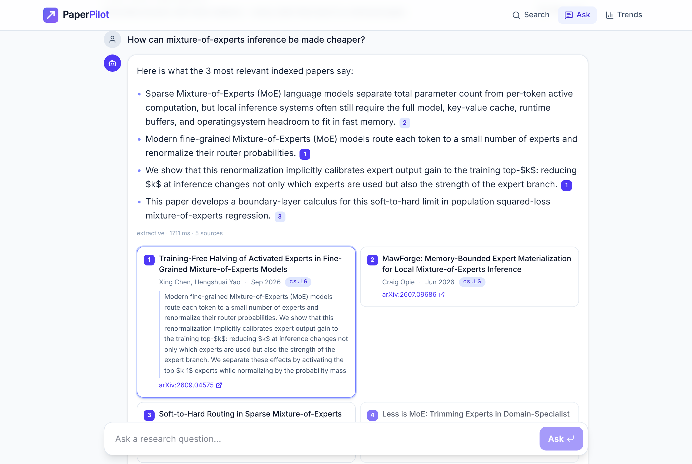
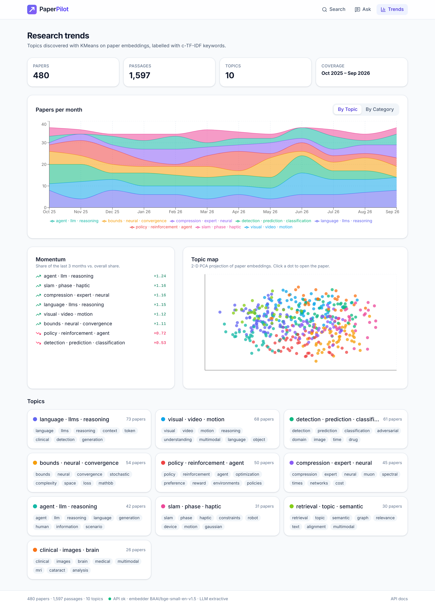
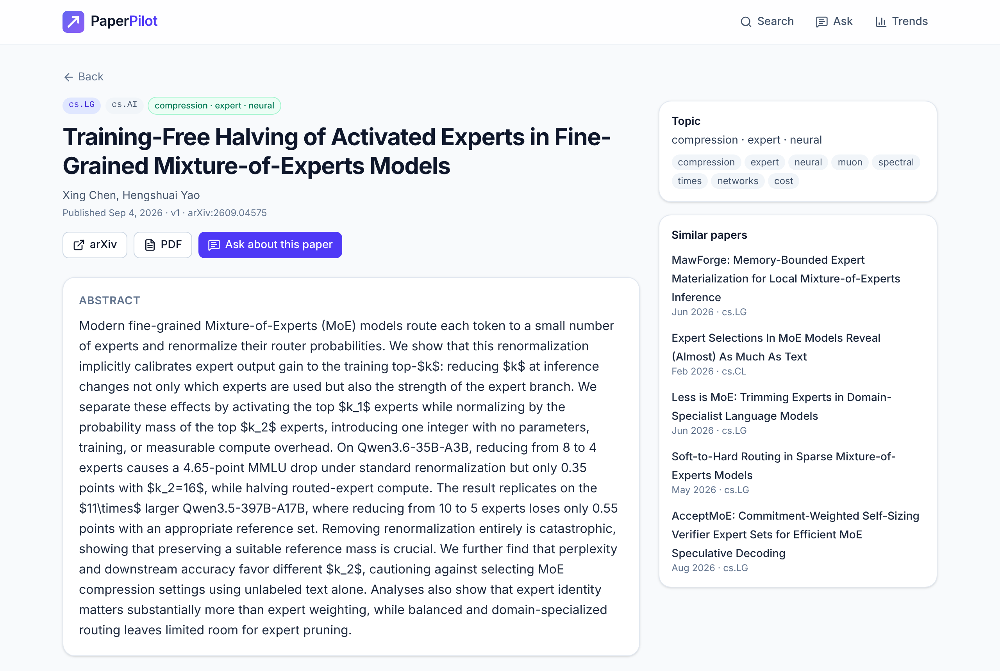
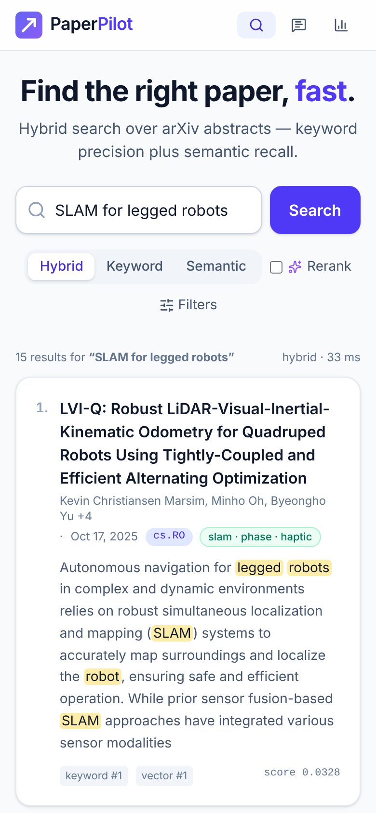
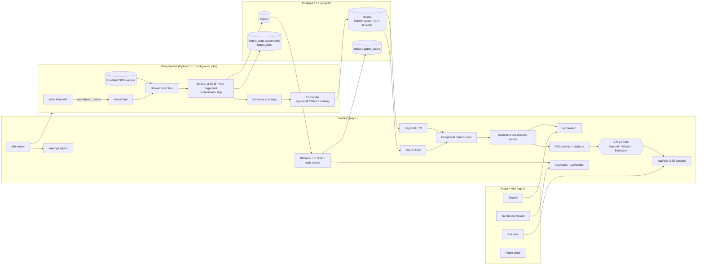

<div align="center">

# 🧭 PaperPilot

**An AI research assistant for arXiv: ingest papers, search them with hybrid retrieval, ask grounded questions with citations, and track research trends.**

[](https://github.com/kshah200419-create/paperpilot/actions/workflows/ci.yml)


[](LICENSE)

Runs entirely offline with **no API keys**. It ships a local ONNX embedding model, a keyless extractive answerer, and a bundled set of 480 real arXiv papers. Plug in OpenAI or Ollama when you want generative answers.



</div>

---

## Contents

- [Features](#features)
- [Screenshots](#screenshots)
- [Architecture](#architecture)
- [Tech stack](#tech-stack)
- [Quickstart](#quickstart)
- [CLI](#cli)
- [API overview](#api-overview)
- [Evaluation](#evaluation)
- [Design decisions & trade-offs](#design-decisions--trade-offs)
- [Project layout](#project-layout)
- [Roadmap](#roadmap)
- [License & data attribution](#license--data-attribution)

## Features

**Data engineering**
- Async arXiv Atom-feed client with polite rate limiting (≥3 s between requests, configurable), exponential-backoff retries on 429/5xx/timeouts, and detection of arXiv's in-feed error entries.
- Normalization pipeline: whitespace/LaTeX cleanup, versionless arXiv IDs, category validation, and sentence-aware abstract chunking with overlap.
- **Idempotent, incremental ingestion:**
  - Upserts by arXiv ID.
  - Skips re-embedding when the content hash and embedding model are unchanged.
  - Removes cross-ID duplicates using a title fingerprint.
  - Keeps a per-query watermark (`ingest_state`) so a re-run stops at the last-ingested date.
  - Commits after each page, so an interrupted run keeps its progress.
- Postgres 17 + **pgvector** schema managed by **Alembic**:
  - HNSW cosine index on chunk embeddings.
  - Generated, weighted `tsvector` (title A, body B) with a GIN index.
- Bundled offline dataset of **480 real arXiv papers (1,597 chunks)** across cs.CL / cs.LG / cs.CV / cs.IR / cs.RO, Oct 2025 – Sep 2026, plus the reproducible script that built it.

**AI / ML**
- Local, keyless embeddings: `fastembed` ONNX **BAAI/bge-small-en-v1.5** (384-d). A deterministic hashing embedder is used for tests and CI, so CI never downloads a model.
- **Hybrid retrieval:** Postgres full-text search and pgvector ANN, fused with **Reciprocal Rank Fusion** (k=60). An optional cross-encoder reranker (`ms-marco-MiniLM-L-6-v2`) is available.
- **RAG with inline citations** `[1]`, streamed over **SSE**, behind a pluggable provider interface:
  - **OpenAI**, when `OPENAI_API_KEY` is set.
  - **Ollama**, when `OLLAMA_HOST` is set.
  - A **keyless extractive** answerer that picks sentences by embedding similarity + term overlap with MMR diversity, citing each one.
  - If a provider fails before emitting a token, the answer falls back to extractive automatically.
- **Topic modeling:** KMeans on embeddings, **c-TF-IDF** keyword labels, a 2-D PCA topic map, and per-month trend counts with a momentum score.
- **Evaluation harness:** 49 hand-labeled queries scored with Recall@k, MRR@k and nDCG@k for keyword vs vector vs hybrid vs reranked retrieval ([results](#evaluation)).

**Backend**
- **FastAPI** + Pydantic v2 + SQLAlchemy 2.x async (asyncpg), fully typed (`mypy --strict` clean).
- Endpoints for search, ask (JSON + SSE), papers, categories, stats, topics, trends, and health. Auto-generated OpenAPI docs are at `/docs`.
- **Background ingestion jobs:**
  - Job status is persisted in Postgres.
  - Jobs that were running when the server stopped are marked failed on restart.
  - Optional `X-Admin-Token` protection.
- Structured logging (structlog; JSON in containers), request-timing middleware, and configuration via `pydantic-settings`.

**Frontend**
- **React 19 + TypeScript + Vite + Tailwind CSS 4**, TanStack Query, React Router, Recharts.
- **Search:** category/date filters, mode switch (hybrid / keyword / vector), and highlighted snippets rendered XSS-safely.
- **Ask:** chat with token-by-token streamed answers, clickable inline citations, and source cards.
- **Trends:** topic momentum, a stacked monthly chart (grouped by topic or category), and a topic map scatter. This page is lazy-loaded so the initial bundle stays small.
- **Paper detail:** metadata, abstract, topic, similar papers.
- Loading / empty / error states throughout, and a responsive layout.

**Quality & DevOps**
- 63 backend tests: unit tests, API tests, and Postgres integration tests that auto-skip when no DB is reachable. 13 frontend tests (Vitest + Testing Library).
- ruff, mypy strict, ESLint (typescript-eslint), Prettier, and pre-commit hooks.
- Multi-stage Dockerfiles: a non-root API image with the model baked in, and an nginx web image with an SSE-safe proxy. `docker compose up` migrates, seeds, and serves everything.
- GitHub Actions jobs:
  - Lint and type-check.
  - Backend tests against a **pgvector service container**.
  - Eval smoke run.
  - Frontend lint, tests, and build.
  - Docker image build.

## Screenshots

These were captured headlessly with Playwright (`npm run screenshots`) against the running app on the bundled dataset.

| Ask (streamed, cited answer) | Trends dashboard |
|---|---|
|  |  |
| **Paper detail** | **Mobile search** |
|  |  |

## Architecture



**Request path for `/api/ask/stream`:**
1. Embed the question.
2. Run keyword and vector retrieval over chunks in parallel candidate pools (50 each).
3. Fuse the results with RRF and cap the number of chunks per paper.
4. Build a numbered context block.
5. Stream tokens from the provider as SSE events: `sources` → `token`… → `done`.
6. The UI renders `[n]` markers as links to the source cards.

## Tech stack

| Layer | Tools |
|---|---|
| Data / storage | PostgreSQL 17, pgvector 0.8 (HNSW), Postgres FTS (`tsvector`, `ts_rank`, `ts_headline`), Alembic |
| ML | fastembed (ONNX Runtime) · BAAI/bge-small-en-v1.5 · ms-marco-MiniLM-L-6-v2 cross-encoder · scikit-learn (KMeans, PCA) · NumPy |
| Backend | Python 3.12, FastAPI, Pydantic v2, pydantic-settings, SQLAlchemy 2 (async) + asyncpg, httpx, structlog, Typer, uv |
| Frontend | React 19, TypeScript, Vite, Tailwind CSS 4, TanStack Query 5, React Router 7, Recharts 3, lucide-react |
| Quality | pytest (+ pytest-asyncio, pytest-cov, httpx MockTransport), ruff, mypy `--strict`, Vitest + Testing Library, ESLint, Prettier, pre-commit, Playwright (screenshots) |
| DevOps | Docker (multi-stage), docker compose, nginx, GitHub Actions with a pgvector service container |

## Quickstart

### Option A: Docker (one command)

```bash
cp .env.example .env        # optional: add OPENAI_API_KEY or OLLAMA_HOST
docker compose up --build
```

- Web UI: http://localhost:8080
- API: http://localhost:8000
- API docs: http://localhost:8000/docs (also proxied at http://localhost:8080/docs)

On first start, the API container:
1. Waits for Postgres.
2. Runs Alembic migrations.
3. Seeds the 480-paper sample and builds topics. This only happens when the DB is empty.

The bge-small model is baked into the image at build time, so it doesn't download at runtime. Build with `PRELOAD_MODEL=false` to skip that step.

### Option B: Local development

Prerequisites: Python 3.12 + [uv](https://docs.astral.sh/uv/), Node 22, and Postgres 17 with pgvector (or `make db` to run just Postgres in Docker).

```bash
make install            # uv sync (with ML extras) + npm ci + pre-commit hooks
make db                 # optional: Postgres + pgvector via docker compose
make seed               # alembic upgrade + load bundled sample + build topics
make api                # FastAPI on :8000 (autoreload)
make web                # Vite on :5173, proxies /api -> :8000
```

Other useful targets:

```bash
make test               # backend (pytest) + frontend (vitest)
make lint typecheck     # ruff, mypy --strict, eslint, prettier, tsc
make eval               # retrieval evaluation -> eval/results/latest.json
make ingest CAT=cs.IR MAX=100   # live, incremental arXiv ingestion
make help
```

Configuration is environment-driven. See [`.env.example`](.env.example) for every option: embedder, reranker, LLM provider, CORS, admin token, and arXiv politeness settings.

## CLI

```bash
paperpilot db upgrade | downgrade | wait
paperpilot seed [--path FILE] [--if-empty] [--k N] [--no-topics]
paperpilot ingest --category cs.LG --max 200          # incremental; --full ignores the watermark, --since overrides it
paperpilot ingest --category cs.CV --query "diffusion transformer" --max 50
paperpilot topics [--k N]
paperpilot eval [--rerank] [--k 10] [--queries FILE] [--output results.json]
paperpilot ask "What are recent approaches to long-context retrieval?" [--max-sources N]
paperpilot serve
```

## API overview

Interactive docs are at `/docs` (Swagger UI) and `/openapi.json`.

| Method | Path | Description |
|---|---|---|
| GET | `/api/health` | Liveness/readiness: DB status, active embedder, LLM provider, reranker |
| GET | `/api/search` | Hybrid search. `q`, `mode=hybrid\|keyword\|vector`, `category`, `date_from`, `date_to`, `limit`, `rerank`. Returns highlighted snippets and per-retriever ranks |
| POST | `/api/ask` | Grounded answer with citations (JSON) |
| POST | `/api/ask/stream` | Same, streamed as Server-Sent Events (`sources`, `token`, `done`, `error`) |
| GET | `/api/papers` | Paginated paper list with filters |
| GET | `/api/papers/{arxiv_id}` | Paper detail, topic, and similar papers |
| GET | `/api/categories` | Category counts |
| GET | `/api/stats` | Corpus statistics |
| GET | `/api/topics` | Topics with c-TF-IDF keywords, size, and momentum |
| GET | `/api/topics/map` | 2-D PCA projection of papers per topic |
| GET | `/api/trends` | Monthly counts per topic |
| POST | `/api/ingest/jobs` | Start a background arXiv ingestion or topic-rebuild job (optional `X-Admin-Token`) |
| GET | `/api/ingest/jobs`, `/api/ingest/jobs/{id}` | Job list and status with live stats |

```bash
curl 'localhost:8000/api/search?q=retrieval+augmented+generation&mode=hybrid&limit=5'
curl -N -X POST localhost:8000/api/ask/stream -H 'content-type: application/json' \
     -d '{"question": "How are LLM agents evaluated?"}'
curl -X POST localhost:8000/api/ingest/jobs -H 'content-type: application/json' \
     -d '{"kind": "arxiv", "category": "cs.IR", "max_results": 50}'
```

## Evaluation

`paperpilot eval` runs the labeled query set in [`backend/src/paperpilot/data/eval_queries.json`](backend/src/paperpilot/data/eval_queries.json) against the seeded database and reports metrics at k=10. The query set has 49 queries:
- **40 known-item queries:** paraphrased descriptions of a specific paper, with that paper as the single relevant item.
- **9 topical queries:** each with several hand-picked relevant papers.

Raw outputs, including per-query nDCG, are in [`eval/results/`](eval/results).

**Corpus:** the bundled 480 papers / 1,597 chunks. **Latency** is the p50 end-to-end retrieval time per query (embedding + SQL + fusion), measured on an 8-vCPU Intel Xeon cloud VM with local Postgres.

### bge-small-en-v1.5 embeddings (default)

| System | Recall@5 | Recall@10 | MRR@10 | nDCG@10 | p50 latency |
|---|---:|---:|---:|---:|---:|
| Keyword (Postgres FTS) | 0.902 | 0.931 | 0.925 | 0.905 | 7.7 ms |
| Vector (pgvector HNSW) | 0.937 | **0.988** | **0.972** | **0.959** | 15.9 ms |
| **Hybrid (RRF)** | **0.947** | 0.967 | 0.966 | 0.947 | 24.5 ms |
| Hybrid + cross-encoder rerank | 0.946 | 0.961 | 0.940 | 0.931 | 366 ms |

Broken down by query type (Recall@5 / Recall@10 / MRR@10 / nDCG@10):

| System | Known-item (n=40) | Topical (n=9) |
|---|---|---|
| Keyword | 0.975 / 0.975 / 0.942 / 0.950 | 0.578 / 0.733 / 0.852 / 0.706 |
| Vector | 0.975 / 1.000 / 0.966 / 0.974 | **0.767 / 0.933 / 1.000 / 0.891** |
| Hybrid (RRF) | **1.000 / 1.000 / 0.971 / 0.978** | 0.711 / 0.822 / 0.944 / 0.808 |
| Hybrid + rerank | 1.000 / 1.000 / 0.963 / 0.972 | 0.706 / 0.789 / 0.837 / 0.752 |

### Deterministic hashing embedder (CI / no-model fallback)

| System | Recall@5 | Recall@10 | MRR@10 | nDCG@10 |
|---|---:|---:|---:|---:|
| Keyword (Postgres FTS) | 0.902 | 0.931 | 0.925 | 0.905 |
| Vector (hashing) | 0.739 | 0.809 | 0.725 | 0.724 |
| Hybrid (RRF) | 0.830 | 0.900 | 0.865 | 0.832 |

**Takeaways**
- **Hybrid gives the best known-item retrieval:** it was the only system to put the target paper in the top 5 for all 40 known-item queries. RRF recovers exact-term matches (method names, acronyms) that the dense model ranks lower.
- **Dense retrieval wins on topical queries.** Keyword search is noisy for broad topics, and fusing it in pulls hybrid below pure vector on that slice. A weighted RRF or a query-type router would be the next experiment.
- **The general-domain MS MARCO cross-encoder did not help here.** It adds about 340 ms and slightly lowers ranking quality on this scientific-abstract corpus, so reranking is off by default (`RERANKER=fastembed` or `?rerank=true` to enable).
- With the weak hashing embedder, fusion still lifts vector-only nDCG@10 from 0.724 to 0.832. Without a good dense model, though, keyword search alone is best.

> **Caveats:** this is a small corpus with a small, hand-labeled query set written by the author, so treat the numbers as indicative rather than benchmark-grade. HNSW is approximate, so results can shift slightly between index builds. The CI workflow re-runs the hashing-embedder eval as a smoke test on every push.

## Design decisions & trade-offs

- **Postgres for everything.** pgvector + native FTS in one database keeps the hybrid query transactional, filterable with plain SQL (`category`, date range), and operationally simple. A separate vector DB or Elasticsearch would scale further but adds two systems to run. Vector search sets `hnsw.ef_search` per query and enables pgvector's `iterative_scan` when filters are present, so filtered queries don't come back short.
- **Chunk-level index, paper-level results.** Abstracts are split into overlapping sentence windows, and the paper title is denormalized into every chunk's weighted `tsvector` and embedding text. Search fuses at paper level (best chunk per paper). RAG fuses at chunk level with a per-paper cap, so a single paper can't take over the context.
- **RRF over score blending.** BM25-style `ts_rank` scores and cosine similarities aren't on comparable scales. Rank fusion needs no calibration and is robust; the measured trade-off is covered under [Evaluation](#evaluation).
- **Keyless by default.** The extractive answerer makes the full experience, including streaming and citations, work offline and in CI. LLM providers are behind a small async-iterator interface, so adding a provider means implementing one small class.
- **Deterministic test embedder.** The hashing embedder (blake2b feature hashing over unigrams + bigrams) means tests and CI never download models and always produce the same results. The `auto` mode degrades to it gracefully if the ONNX model is unavailable.
- **Picking the number of topics.** Silhouette scores on 384-d sentence embeddings were flat (≈0.04–0.08) and always favored the minimum k, which produced uninformative topics. PaperPilot uses a size heuristic instead, `k = clip(√(n/5), 4, 15)`, which gives 10 topics for 480 papers, and reports silhouette for transparency. HDBSCAN + UMAP is on the roadmap.
- **In-process background jobs.** Ingestion runs as asyncio tasks, with job status persisted in Postgres and interrupted jobs recovered on restart. This avoids a Redis/Celery dependency for a single-node deployment. The trade-off is that jobs don't survive a crash mid-run, though per-page commits and watermarks make re-running safe.
- **Polite arXiv usage.** The client follows arXiv's API guidance: sequential requests, ≥3 s apart, a descriptive User-Agent, and backoff on 429/503. The sample-dataset builder caches each response so it can resume.
- **SSE over WebSockets.** Answer streaming is one-directional, so SSE (with `fetch` + `ReadableStream` on the client, and nginx buffering disabled) is simpler and works through standard proxies.

## Project layout

```
paperpilot/
├── backend/
│   ├── src/paperpilot/
│   │   ├── api/            # FastAPI app, routes, schemas, background jobs
│   │   ├── db/             # SQLAlchemy models, async session, Alembic runner
│   │   ├── ingest/         # arXiv client, normalization, chunking, pipeline
│   │   ├── ml/             # embedders, reranker, topic modeling
│   │   ├── retrieval/      # keyword / vector search, RRF fusion
│   │   ├── rag/            # prompt building, LLM providers, answer service
│   │   ├── eval/           # IR metrics + evaluation harness
│   │   ├── data/           # bundled 480-paper sample + labeled eval queries
│   │   └── cli.py          # `paperpilot` Typer CLI
│   ├── alembic/            # migrations
│   ├── tests/              # unit/ + integration/ (Postgres) + fixtures/
│   ├── scripts/            # reproducible sample-dataset builder
│   └── Dockerfile
├── frontend/
│   ├── src/{api,components,hooks,pages,lib,test}/
│   ├── scripts/screenshots.mjs
│   ├── nginx.conf
│   └── Dockerfile
├── eval/results/           # measured evaluation outputs (JSON)
├── docs/screenshots/       # real UI captures
├── .github/workflows/ci.yml
├── docker-compose.yml
└── Makefile
```

## Roadmap

- [ ] Full-text ingestion (arXiv HTML/PDF → section-aware chunks)
- [ ] HDBSCAN + UMAP topics with topic evolution over time
- [ ] Weighted / query-adaptive fusion; domain-tuned reranker (e.g. a SciRepEval-trained model)
- [ ] Answer-quality evaluation (citation precision, faithfulness via LLM-as-judge)
- [ ] Durable job queue (e.g. Arq/Redis) and scheduled incremental ingestion
- [ ] Auth, saved searches, and per-user reading lists
- [ ] OpenTelemetry tracing and Prometheus metrics

## License & data attribution

Code is released under the [MIT License](LICENSE).

Paper metadata in the bundled sample comes from the [arXiv API](https://info.arxiv.org/help/api/index.html). arXiv metadata is available under CC0 1.0. *Thank you to arXiv for use of its open access interoperability.* PaperPilot is not affiliated with or endorsed by arXiv.
